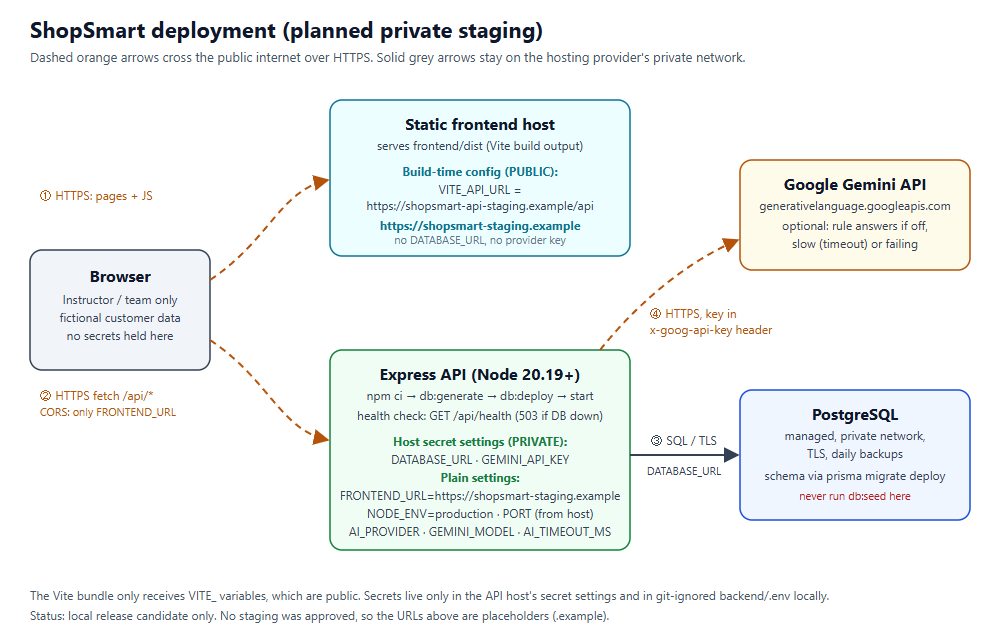

# ShopSmart deployment plan

**Status: local release candidate only.** The class has not approved hosting or a database, so nothing was deployed. The plan below is what we would do for a **private staging** environment once a host is approved. All URLs ending in `.example` are placeholders.

Source: [`deployment-diagram.svg`](deployment-diagram.svg)

## Services and connections

| # | From → To | Crosses the internet? | Protocol | Configuration used |
|---|-----------|-----------------------|----------|--------------------|
| ① | Browser → static frontend host | **Yes** | HTTPS | none (public files) |
| ② | Browser → Express API | **Yes** | HTTPS `fetch` to `/api/*` | `VITE_API_URL` (in the bundle), `FRONTEND_URL` (CORS on the API) |
| ③ | Express API → PostgreSQL | No: private network of the host, TLS | PostgreSQL wire protocol | `DATABASE_URL` (secret) |
| ④ | Express API → Google Gemini | **Yes** | HTTPS, key in the `x-goog-api-key` header | `GEMINI_API_KEY` (secret), `GEMINI_MODEL`, `AI_TIMEOUT_MS`, `AI_PROVIDER` |

The browser never talks to PostgreSQL or Gemini directly. Gemini is optional. If it is off, slow or failing, the API answers from catalog rules, as shown in screenshots 12 and 15.

## Configuration per service

| Service | Setting | Public or secret | Where it is stored |
|---------|---------|------------------|--------------------|
| Frontend (build) | `VITE_API_URL=https://shopsmart-api-staging.example/api` | **Public.** Vite copies every `VITE_` variable into the JavaScript bundle. | Frontend host's build environment settings |
| API | `DATABASE_URL` | **Secret** | API host's secret/environment settings, never in git |
| API | `GEMINI_API_KEY` | **Secret** | API host's secret settings, never in git or the frontend |
| API | `FRONTEND_URL=https://shopsmart-staging.example` | Public | API host's environment settings |
| API | `NODE_ENV=production`, `PORT` (set by the host), `AI_PROVIDER`, `GEMINI_MODEL`, `AI_TIMEOUT_MS` | Public | API host's environment settings |
| Database | user, password, network allow-list | **Secret** | Database host; the password only appears inside `DATABASE_URL` |

## Answers to the plan questions

1. **Where will the Vite build files be hosted, and which API URL will the frontend use?**
   The `frontend/dist` folder from `npm run build` goes on a static host, for example a static-site service on the approved platform. `VITE_API_URL` is set in that host's build settings to the API's public URL, `https://shopsmart-api-staging.example/api`. The app uses `BrowserRouter`, so the host needs a rewrite rule that sends every path to `index.html`. Without it, refreshing `/cart` or `/products/2` returns the host's 404 page.

2. **Where will the Express server run, and what public URL serves `/api/health`?**
   It runs as a Node 20.19+ web service on the approved platform (build `npm ci && npm run db:generate`, start `npm start --workspace backend`). The health URL is `https://shopsmart-api-staging.example/api/health`, and the host's health check should point there. Since fix **D3**, this endpoint runs `SELECT 1` and returns **503** `{"status":"degraded","database":"unreachable"}` when PostgreSQL cannot be reached. Before the fix it returned 200 even with the database down. The API sits behind the host's proxy, so `app.set('trust proxy', 1)` must be added for staging. Without it, `express-rate-limit` puts every customer in the same bucket.

3. **Where will PostgreSQL run, and how will the server receive `DATABASE_URL` securely?**
   It runs on a managed PostgreSQL instance from the same provider and region, reachable only from the API service (private network or IP allow-list), with TLS (`sslmode=require`) and automatic backups. The connection string is pasted once into the API host's **secret** settings. It never goes into git, the README, screenshots or the frontend.

4. **Which origin will `FRONTEND_URL` and the API CORS configuration allow?**
   Exactly one origin: `https://shopsmart-staging.example`, with scheme, host and no trailing slash. `backend/src/app.js` passes it to `cors({ origin: process.env.FRONTEND_URL })`, so requests from any other site get no CORS header and the browser blocks them.

5. **Where will the provider key be stored, and how is it kept out of the bundle and the repository?**
   `GEMINI_API_KEY` exists only in the API host's secret settings and, locally, in `backend/.env`. That file is listed in `.gitignore`, and our check confirmed it was never committed. The variable has no `VITE_` prefix and is only read in `backend/src/services/aiProvider.js`, so Vite cannot include it in the bundle. The release check scans `frontend/dist` for the key and for `DATABASE_URL`, `postgresql://` and `GEMINI` (see `release-note.md`).

6. **How will migrations be applied before first use without wiping orders?**
   Through `npm run db:deploy` (new script → `prisma migrate deploy`), run as the API's release/pre-start step against the staging database. `migrate deploy` only applies committed migrations from `backend/prisma/migrations` that are not yet recorded in `_prisma_migrations`. It never resets the database, generates new migrations or uses a shadow database.
   - **Do not** use `npm run db:migrate` (`migrate dev`). It is for local development and can ask to reset the database when it finds drift.
   - **Do not** run `npm run db:seed`. `prisma/seed.js` deletes all order items, orders and products first.
   - To load a starting catalog into an empty staging database, insert the products once by hand (or with a one-off script that only inserts) and record it in the deployment log.
   - Take a database backup before each deploy that includes a new migration.
   - Local check: `npx prisma migrate status` reports "1 migration found … Database schema is up to date!" (`evidence/05-migrate-status.txt`).

7. **Who can access staging, and will only fictional data be used?**
   Only the instructor and the team. The approved platform's access protection (password/team access or IP allow-list) stays enabled, the URL is shared privately, and search engines are blocked. The app has **no sign-in**, and `POST /api/orders` stores a name, email and address. Staging must therefore never be opened to the public, and testers type only fictional details such as "Juan Dela Cruz" / `juan.delacruz@example.com`.

## Deployment steps (when approved)

1. Create the PostgreSQL instance and copy its connection string into the API service's secret `DATABASE_URL`.
2. Create the API service. Set the settings in the table above, run `npm ci`, `npm run db:generate` and `npm run db:deploy`, then start it. Open `/api/health` and expect `{"status":"ok","database":"ok"}`.
3. Load the fictional catalog once (insert only, no seed script).
4. Create the static frontend with `VITE_API_URL` set, run `npm ci` and `npm run build --workspace frontend`, publish `frontend/dist`, and add the SPA rewrite to `index.html`.
5. Set `FRONTEND_URL` on the API to the frontend's exact origin and restart.
6. Repeat the smoke test from `release-note.md` against the staging URLs, recording the date, the URLs and each result, with no credentials visible in screenshots.

## Rollback

- Redeploy the previous frontend build and API commit. Migrations are additive, so the older API keeps working against the newer schema.
- Restore the database from the pre-deploy backup only if a migration damaged data.
